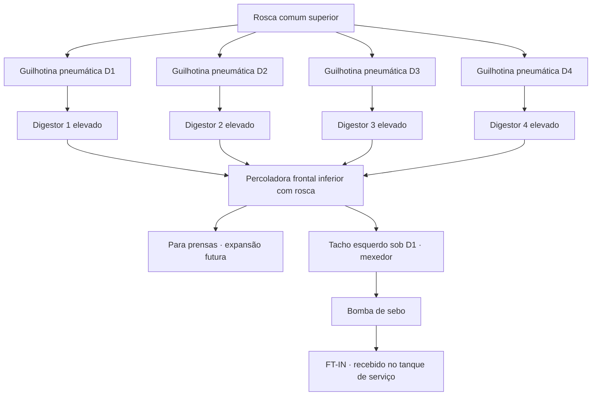
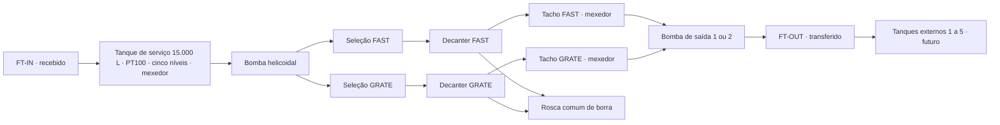

# 2A — Circuitos dos digestores e decanters, simulação e futura integração

**2A Automação Industrial — Ângelo Gomes da Silva — Fundador.** Módulo integrado ao CAD, sistema de manutenção do Campo do Gado. Esta revisão usa o circuito descrito pelo responsável e as imagens enviadas como referência de arranjo. Desenhos sem escala; não constituem projeto executivo de automação.

## O que já existe

- Identidade 2A no módulo, cenas Three.js locais, esquemas SVG e supervisão por origem explícita.
- Firmware V9 dos digestores: temperatura simulada gerada no computador sem exigir PT100 físico; modo REAL separado, com leitura física local quando o sensor estiver configurado.
- Sinaleiros: GPIO18 vermelho, GPIO19 amarelo e GPIO21 verde; relés ativos em LOW. Faixas: 0–50 °C verde, acima de 50 e abaixo de 100 °C amarelo, 100–120 °C vermelho, acima de 120 °C vermelho piscando. A indicação térmica não autoriza descarga automática.
- Dois purgadores por digestor: GPIO25 camisa/canal 1 e GPIO26 eixo/canal 2, relés ativos em LOW, válvulas que fecham sem energia conforme confirmado pelo responsável. Armamento e tempos locais na IHM do ESP32; teste CAD depende de autorização local por canal e comunicação válida. Não há retorno físico de posição.
- Wi-Fi/token permanecem na IHM e NVS existentes. Configuração de credenciais no CAD continua exclusiva de ADMIN. Módulo/fiação/referência do PT100 e detalhes elétricos de potência ainda exigem confirmação.
- Base publicada na [PR #700](https://github.com/angelogds/CAD/pull/700), com 1.476 testes aprovados. Detalhes: [V9](automacao-simulacao-cad-v9.md), [módulo 2A](automacao-2a-3d.md) e [instrumentação](automacao-2a-instrumentacao.md).

## Arranjo dos digestores informado em campo

D1, D2, D3 e D4 ficam elevados, da esquerda para a direita, numa plataforma. A rosca comum fica acima e alimenta cada digestor por sua própria guilhotina com acionamento pneumático. A descarga frontal cai na percoladora abaixo e à frente dos vasos. A percoladora é uma caixa maior com rosca interna que transporta o material para a futura área de prensas.

Abaixo da percoladora, do lado esquerdo sob D1, fica o tacho coletor de sebo com mexedor central. Uma bomba transfere esse sebo ao tanque de serviço das decanters; a medição FT-IN prevista nesse tanque contabiliza o recebido. O coletor de gases comum aparece apenas como referência esquemática para o tratamento, sem vazão, condição ou acionamento real inferidos.

## O que muda nesta revisão

- Circuito dos digestores incluído na supervisão e no simulador existente, preservando os cards térmicos e a sincronização ESP32.
- Ensaio mecânico local seleciona D1, D2, D3, D4 ou todos; demonstra carga, mistura, descarga e transferência. No cenário Todos, as entradas são percorridas em série, com uma guilhotina virtual aberta por vez.
- Eixos, roscas, mexedores e trajetórias têm movimento condicionado ao estado da maquete. Na supervisão, sinais mecânicos ausentes continuam desconhecidos e estáticos.
- Rótulos HTML com tipografia constante na tela, contraste e linhas de referência substituem as texturas minúsculas do 3D. As legendas também selecionam o equipamento.
- Tanques externos T1–T5 são afastados da linha de alimentação das decanters, tanto no SVG quanto na cena 3D. Continuam como expansão futura, sem capacidade ou nível real presumidos.
- FAST, GRATE ou ambas podem operar no cenário virtual; o responsável confirmou que “duas prensas” nessa solicitação significava FAST e GRATE. As prensas continuam em sua página, como expansão futura.
- Em ambas, a vazão virtual total se divide entre as duas. Falha de prontidão ou tacho alto em qualquer uma retira a alimentação conjunta, sem rearme automático.
- Mexedores virtuais nos dois tachos das decanters; sem produto, eles param. Bombas 1 e 2 continuam exclusivas. Alternância opcional a cada 60 segundos virtuais de transferência, apenas como exemplo; a sucção continua no tacho escolhido. A alternância não troca silenciosamente de tacho e não rearma após secagem ou bloqueio.

## Simulação local e dados reais

O novo ensaio mecânico dos digestores não escreve no ESP32, não clica nos comandos térmicos existentes e não publica estados na API da bancada. O simulador térmico e a sincronização V9 continuam separados. A animação de uma guilhotina não significa que uma saída pneumática foi implementada no firmware.

Tempos, carga de 600 L da maquete, fração ilustrativa de líquido de 25% e tacho de 1.000 L no ensaio dos digestores são parâmetros gráficos, não capacidades ou rendimento industrial aferidos. Nos tachos das decanters, os 1.000 L e as vazões também são exemplos. Nenhum contador da sessão constitui produção oficial.

O tanque de serviço tem capacidade nominal informada de 15.000 L. Os cinco patamares propostos — 10, 25, 50, 75 e 90% — dão seis faixas aproximadas, após cubagem. Não equivalem às mesmas porcentagens de altura. FT-IN mede recebido; FT-OUT mede transferido. Produção apurada exige uma fronteira de medição e considerar estoques, retornos e recirculação. Início/fim do turno noturno devem ser definidos em America/Sao_Paulo.

A serpentina permanece fora do desenho conforme solicitado. O PT100 indica temperatura no ponto de medição; um retorno de motor não comprova homogeneidade e posição de válvula não comprova fluxo de vapor.

## Permissões

| Perfil | Decanters | Novo ensaio mecânico dos digestores | Bancada ESP32 e tokens |
| --- | --- | --- | --- |
| ADMIN | Supervisão e simulação local | Permitido | APIs de sincronização e configuração existentes |
| Supervisor de Manutenção | Supervisão e simulação local | Permitido | Sem ampliação de acesso a tokens ou sincronização CAD |
| Encarregado de Manutenção | Supervisão e simulação local | Permitido pelo simulador | Sem ampliar supervisão de outras áreas ou configuração |
| Diretoria | Supervisão, sem controles de simulação das decanters | Sem controles mecânicos; visual térmico legado preservado | Sem sincronização/configuração |
| Demais perfis | Sem nova autorização | Sem nova autorização | Sem nova autorização |

As rotas aplicam autorização no servidor e as páginas não entregam controles mecânicos fora dos perfis permitidos. A liberação local de cada purgador no ESP32 continua sendo uma ação própria, separada do perfil de acesso ao CAD.

## Sinais a levantar para a futura implementação

Tags abaixo são conceituais; não são endereços nem pinos liberados para instalação.

| Conjunto | Leituras/retornos propostos | Comandos futuros a estudar | Dependências |
| --- | --- | --- | --- |
| Rosca de alimentação | Motor, falha, rotação efetiva, carga e caminho disponível | Partida/parada no controle local | Acionamento, proteção e sequência existentes |
| Cada guilhotina D1–D4 | Fim de curso aberta/fechada, ar disponível e diagnóstico de divergência | Distribuidor pneumático a definir | Tipo de válvula/cilindro, comportamento sem energia/ar, proteção e permissivos |
| Cada digestor | PT100, acionamento/eixo, falhas, condições de acesso e descarga | Somente projeto futuro próprio | Intertravamentos de máquina, condição térmica/pressão e procedimento aprovados |
| Percoladora | Rotação, corrente/falha, presença/nível de material, saída disponível | Acionamento local a estudar | Capacidade, descarga e sequência com prensas |
| Tacho coletor dos digestores | Nível mínimo/alto, temperatura quando aplicável, retorno do mexedor | Mexedor e bomba por lógica local aprovada | Capacidade útil, sucção e proteção contra secagem/transbordo |
| Transferência ao tanque de serviço | Vazão/total FT-IN, qualidade e tempo de leitura | Bomba/rota somente após engenharia | Medidor apropriado ao sebo quente, tubulação e destino |
| Tanque de serviço | Cinco níveis, PT100, rotação do mexedor, retorno de vapor | Controle local futuro | Cubagem, faixa térmica aprovada e instrumentos |
| FAST/GRATE | Prontidão, velocidade/diferencial, torque, vibração, mancais e falhas do controle existente | Não substituir a sequência OEM por animação | CLP, rede, protocolo, permissivos e documentação OEM |
| Tachos e bombas de saída | Níveis, rotação/falha, vazão/pressão e retorno de rota | Seleção/alternância local a validar | Topologia real, retenções, destino e capacidade disponível |
| Armazenamento T1–T5 | Instrumentação ainda a definir | Fora da implantação atual | Capacidades, rotas e levantamento de campo |

Para cada sinal, registrar origem REAL/SIMULACAO, qualidade, unidade, timestamp, idade e fonte. Comando solicitado, retorno elétrico e movimento/posição mecânica são informações distintas. Perda de comunicação não deve conservar uma animação como confirmação de funcionamento.

## Próxima implantação física

1. Conferir o desenho com fotos, dimensões, sentido de fluxo, posições dos equipamentos e tags cadastrais.
2. Levantar manuais, CLPs/inversores, interfaces, tensão, relés e lista de I/O, sem expor credenciais.
3. Definir matriz causa/efeito, permissivos, estados na perda de energia/ar/comunicação e responsabilidade do controle local. Não basear abertura de comporta apenas em temperatura.
4. Priorizar leitura supervisionada e comissionamento por conjunto, mantendo as proteções e sequências existentes.
5. Só depois desenvolver firmware/controle físico específico para roscas, comportas, mexedores e bombas. Nenhum desses novos canais foi adicionado ao V9 nesta revisão.
6. Validar sensores, retornos, identificação, falhas, watchdog e contadores em testes de campo preparados pela equipe responsável.

## Rastreabilidade

Registro privado no [Notion](https://app.notion.com/p/4057ddca327c819980e7d8210af8faf7?pvs=204).

- Solicitação: descrição de campo e três imagens fornecidas nesta conversa; clarificação confirmou FAST/GRATE como as duas máquinas.
- Histórico Notion: [Decanters V1](https://app.notion.com/p/3f97ddca327c81ddbff8fdb019c32e23) e [Prensas/CLPs](https://app.notion.com/p/3f97ddca327c81089a8ff52b30d5185a). Esses registros históricos não comprovam integração atual.
- Implementação: views/parciais de automação, núcleos locais dos dois circuitos, modelos Three.js e viewer/rótulos compartilhados.
- Sem migrations, novas dependências ou alteração dos comandos industriais/firmware.
- Os resultados da CI e o link da PR desta revisão constam no registro de entrega e na documentação do Notion.
- Desenhos exportáveis: [Digestores](entrega/2A-Circuito-Digestores-V2.svg) e [Decanters](entrega/2A-Circuito-Decanters-V2.svg). Para regenerar: `node scripts/export-automacao-circuitos.cjs`.
